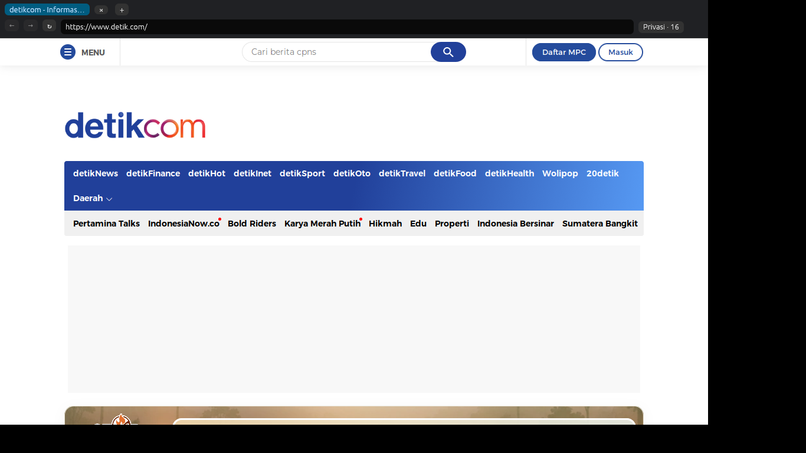
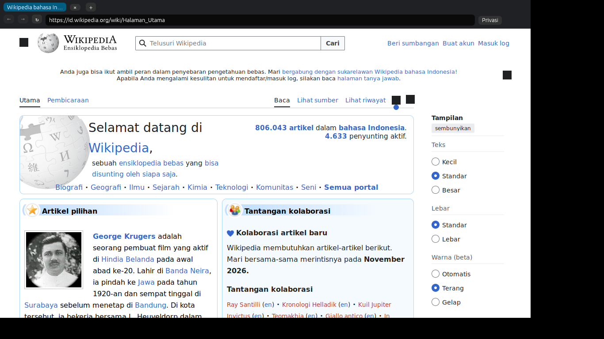
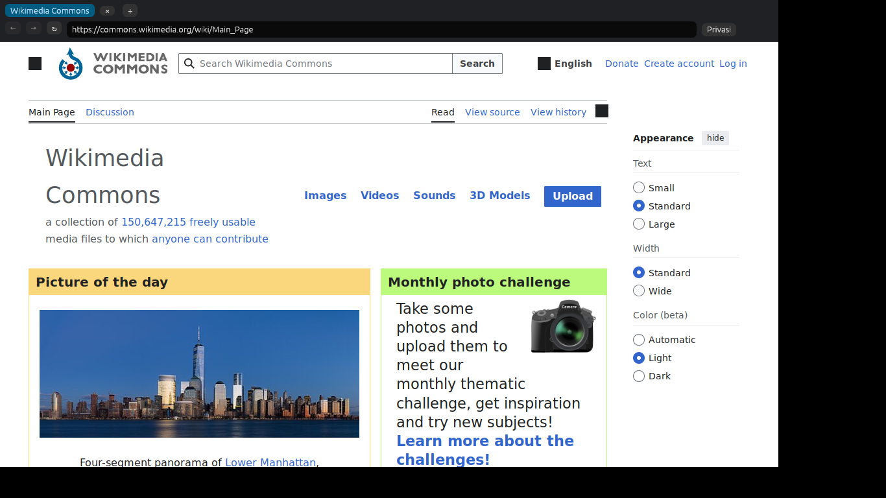

# Hasil uji situs Lumen

Build: nightly-20261128-953edcb · dijalankan 2026-11-28 02:36 UTC

| Situs | RAM (RSS) | Iklan/pelacak diblokir |
|---|---|---|
| [berita-kompas](https://www.kompas.com/) | 1286 MB | 30 |
| [berita-detik](https://www.detik.com/) | 544 MB | 16 |
| [gambar-unsplash](https://unsplash.com/) | 607 MB | 6 |
| [gambar-wikimedia](https://commons.wikimedia.org/wiki/Main_Page) | 397 MB | 0 |
| [video-youtube](https://www.youtube.com/) | 220 MB | 0 |
| [video-vimeo](https://vimeo.com/) | 792 MB | 44 |
| [ensiklopedia-wikipedia](https://id.wikipedia.org/) | 369 MB | 0 |

## berita-detik

## berita-kompas

## ensiklopedia-wikipedia

## gambar-unsplash

## gambar-wikimedia

## video-vimeo

## video-youtube

